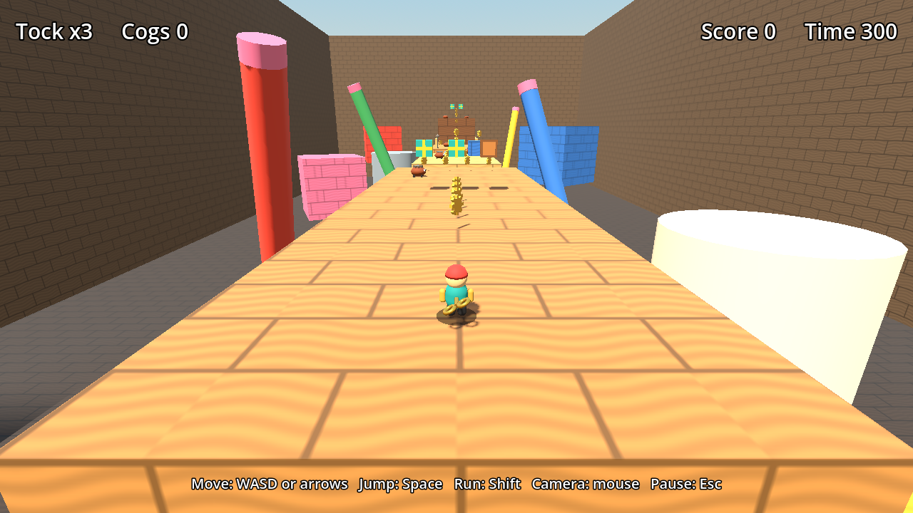
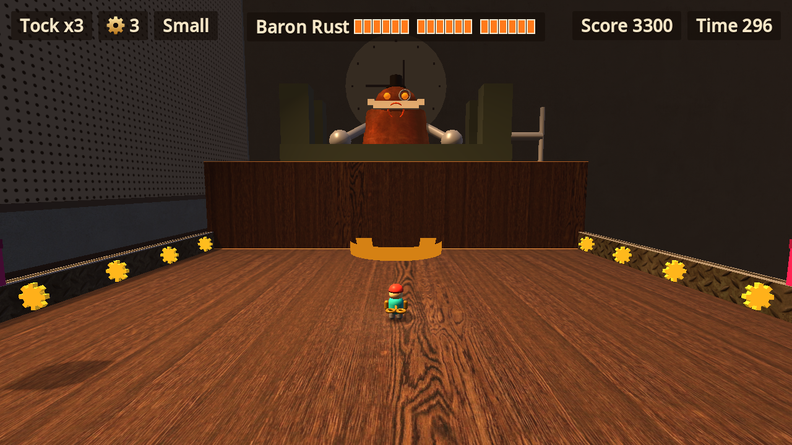

# Tock's Wind-Up Workshop

An original 3D platformer made with Godot 4.7. Play as Tock, a tiny clockwork toy racing across a real craftsman's workshop at dusk: stomp rusty gear-beetles, dodge bombing paper planes and sniping rubber ducks, skid through wet paint, ride giant wrenches, and take on Baron Rust, a vain old bench vise with a very small hat.





> **Status: complete campaign, not yet playtested by people.** All five levels and the boss fight can be played from start to finish, and bots finish every level in automated tests. Difficulty and jokes still need a human opinion.

## Play it

1. Install [Godot 4.7](https://godotengine.org/download). On Windows you can run `winget install GodotEngine.GodotEngine`.
2. Clone this repository.
3. From the project folder, run:

```bash
godot --path .
```

If `godot` isn't recognized, use the full path to the Godot executable instead. You can also open `project.godot` in the Godot editor and press F5.

To make a Windows or browser build, see the [deploy guide](docs/release/deploy-guide.md).

## Controls

| Action | Keyboard and mouse | Gamepad (tested with simulated input only) |
|---|---|---|
| Move | WASD or arrow keys | Left stick |
| Jump (hold to jump higher) | Space | A |
| Run | Shift | X |
| Fire (with the Bolt Blaster) | F or left mouse button | RB or B |
| Camera | Mouse, or Q and E | Right stick |
| Pause | Esc | Start |

## What's in the game

- **The story:** an intro on launch shows why Tock is racing the clock, and an outro follows the win. Any button skips them, and the Reduced motion setting turns them off.
- **Movement:** walking, running and variable-height jumps, with forgiving jump timing at ledges and on landing.
- **Five levels:**
  1. **Workbench Run:** the gentle start, with benches, a moving platform and a spring pad.
  2. **Junk Drawer Dash:** a pencil bridge, battery stepping stones, rubber-band launchers and your first Blaster.
  3. **Paint Shelf Panic:** slick wet paint that won't let you stop, and rubber ducks that snipe you while you slide.
  4. **Toolbox Tumble:** giant wrenches that shuttle, lift and sweep, chattering teeth, and the longest jump in the game.
  5. **Baron Rust's Vise:** the final boss, in three phases of slams, thrown wrenches, flying dentures and a rust sweep.
- **Enemies:**
  - **Gear-beetles** patrol. Stomp them from above, because any other contact hurts.
  - **Armored beetles** wear a saucepan lid, take two stomps, and panic in between.
  - **Paper-plane bombers** drop erasers, then swoop low enough to stomp.
  - **Rubber-duck snipers** squeak, inflate, spit a bubble and blow a raspberry.
  - **Chattering teeth** hop after you, then laugh at the ledge they won't cross.
- **Toy boxes:** bump them from below for cogs, a power-up or a spare key. Some are hidden, and each level hides a secret.
- **Powers:** each hit takes away the top one.
  - **Coil Spring** makes Tock bigger, lets him jump higher and break crates, and lets him survive one extra hit.
  - **Bolt Blaster** adds fire. Aim by facing the target, and a ring shows what you'll hit, including things above you.
- **Campaign:** lives, cogs, score and your power carry between levels. A Game Over lets you retry the level, which is counted, or start a new run. Beating the Baron pays a bonus for lives left and a bigger one if you never retried.
- **The workshop:** real wood, metal, plaster and concrete textures, warm lamp lighting, a dusk window, and a pegboard with hung tools. Tock and the beetles are well-made toy figures rather than photoreal characters, because everything is built in code without imported models.
- **Game systems:** cogs, lives, score, a timer, a HUD, menus and sound effects generated in code.
- **Replay value:** progress saves automatically. Clearing a level opens it in the level select, each level keeps its best time, and levels 1 to 4 each hide three golden gears. The title shows your best full-run score.
- **Options:** Graphics Low or High (High adds smooth edges, glow and sharper shadows), Fullscreen (also F11) and Reduced motion. The game starts on Low on integrated Intel graphics and in the browser.
- **Effects:** sparks when you stomp, a glint on every pickup and dust on hard landings.

## What we did

This game was built with [Claude Code](https://claude.com/claude-code), on top of the [Claude Code Game Studios](https://github.com/Donchitos/Claude-Code-Game-Studios) template.

1. **Set up the tools.** Installed the template and the `find-skills` skill, and reviewed the template's automatic hooks before adding them.
2. **Chose an original concept.** Designed a new hero, world and enemies, written up in the [game brief](design/game-brief.md).
3. **Built the first playable.** Wrote the movement, camera, enemies, level, menus and sound in GDScript, with gameplay values kept in [data files](assets/data/data_reference.md) so they can be tuned without code changes.
4. **Tested it.** Added 31 automated tests that run the real game with real physics, including a bot that finishes the whole course. Breaking the jump height on purpose made the bot fail, which confirms that test can catch an impossible level.
5. **Tuned it for low-end hardware.** Measured frame rate on an Intel HD 520 and changed settings based on the results, reaching a steady 60 FPS on the title screen. Gameplay ran at about 90 FPS uncapped when measured, and is capped at 60.
6. **Upgraded the visuals with the studio's specialists.** Used `find-skills` to find and install the `godot-shaders` and `godot-ui-control` skills, and added free [CC0 textures](assets/textures/texture_sources.md). The studio's art director wrote the [art bible](design/art/art-bible.md), and its technical artist rebuilt the materials, lighting and scenery from it. Merging meshes also made the game faster: the slowest spot measured went from about 57 FPS to about 80 FPS uncapped. Glow was cut because it cost too much on this hardware, and edges remain jagged because anti-aliasing is off.
7. **Rebuilt the menus and added gamepad support.** The studio's UI programmer added a cast-brass title over the live 3D scene, restyled the other screens and HUD, and made menus and play work with a controller. Those controller tests use simulated events, so a real controller is still unproven. There are now 58 automated tests.
8. **Fixed a playtest bug.** Holding an arrow key made the 3-button menu spin so fast that it often stopped on the opposite button. Menus now stop at their ends, and one press moves one step.
9. **Expanded it to a full campaign.** The studio's game designer wrote the [expansion spec](design/expansion-spec.md) with exact jump margins for every gap. Its gameplay programmer built most of the Bolt Blaster and the four new enemies, and Claude Code then built slick paint, moving wrenches, three new levels and the Baron Rust fight directly from the spec. Screenshots caught problems the tests could not, such as the Baron standing out of frame, so the fight got its own camera.
10. **Tested the campaign.** Bots finish levels 2, 3 and 4, walking except for the run jumps, and making Tock slower or weaker on purpose makes them fail. Other bots beat the Baron with stomps alone, with bolts alone, and with no protection at all by dodging. In the final measurement on the Intel HD 520, after several back-to-back runs, every spot checked stayed above 60 FPS uncapped, with the lowest at 64, and a stress test of the busiest allowed scene held 66 FPS. An earlier run of that stress test on a hot, busy laptop dipped to about 55 FPS, so the worst moments may still drop slightly below 60 there.
11. **Played it, then had the studio's specialists review it.** The level designer, art director and QA lead each reviewed the finished game. Their findings led to fixes for real bugs, such as a gamepad tap of B on an end screen throwing away the whole run, and a death during a phase break refilling too much of the Baron's health. They also led to fairer enemy placement, gentler timing on level 4's wrench relay, two extra checkpoints, and clearer colors, including a much bigger moustache.
12. **Added an intro and an outro.** Claude Code wrote the story and directed the shots inside the real game engine, then cut them together with [HyperFrames](https://github.com/heygen-com/hyperframes), using the game's own sound effects. The films have no music yet. How to rebuild them is in [video/README.md](video/README.md). There are now 177 automated tests.
13. **Made it ready to sell.** Following the [release spec](design/release-spec.md), Claude Code added saved progress, a level select, best times, golden gears, an options page with a graphics quality setting, particle effects, credits, a game icon and a store cover. It then built a Windows version and a browser version, and checked that both start and play the intro. The release notes for itch.io are in [docs/release](docs/release/deploy-guide.md). On the Intel HD 520, High quality runs at about 28 FPS, so that laptop stays on Low. There are now 195 automated tests.
14. **Made a trailer.** Claude Code directed a 44-second [3D cartoon trailer](docs/release/trailer/tocks-wind-up-workshop-trailer.mp4) in the Brick Toy style of the [Lemo-Opuscar](https://github.com/lemomo-ai/lemo-opuscar) film library: Tock, Baron Rust and the Golden Key rebuilt from toy bricks on a real desk, with an original score from CC0 samples. Its plan, credits and source are in [docs/release/trailer](docs/release/trailer/TREATMENT.md).

## Project layout

| Folder | Contents |
|---|---|
| `src/` | Game code: `core`, `gameplay`, `ui` and `audio` |
| `assets/` | Tuning data, level layouts, textures and the films |
| `video/` | Sources for the intro and outro films |
| `design/` | Game brief and design documents |
| `docs/release/` | itch.io store text, cover, screenshots, trailer and deploy guide |
| `tests/` | Unit and integration tests |
| `tools/` | Screenshot, frame-rate and film-recording tools |
| `.claude/` | Studio agents, skills, hooks and rules from the template |

## Run the tests

```bash
godot --headless --path . --import
```

```bash
godot --headless --path . --fixed-fps 60 -s res://tests/run_tests.gd
```

The test run exits with 0 if everything passed, 1 on failures, 2 if no tests were found and 3 if a test stalled.

## Roadmap

- Playtesting with people, then tuning difficulty from what they find
- Testing on a real controller
- Music
- Publishing on itch.io, following [the deploy guide](docs/release/deploy-guide.md)

## Credits and licenses

- **Studio template:** [Claude Code Game Studios](https://github.com/Donchitos/Claude-Code-Game-Studios) by Donchitos, under the [MIT License](LICENSE). Its original README is kept at [docs/studio-template-readme.md](docs/studio-template-readme.md).
- **Textures:** [Poly Haven](https://polyhaven.com), under CC0.
- **Engine:** [Godot Engine](https://godotengine.org), under the MIT License.
